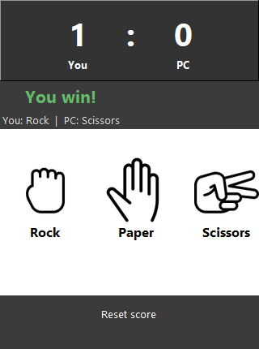

# Rock, Paper, Scissors

A small rock-paper-scissors game with two frontends: a **desktop app** built with Python + tkinter and a **playable web page** hosted on GitHub Pages. Rules: rock beats scissors, scissors beats paper, paper beats rock; equal moves are a draw.



**Play in your browser:** https://marlonwq.github.io/Rock-Paper-Scissors/

## Features

- Three clickable hand buttons (rock, paper, scissors) with keyboard shortcuts `1`, `2`, `3`.
- Random computer move, result message and running score.
- Best-of-3 mode on the web page: first to two wins takes the match (toggle it off for endless single rounds).
- Reset button / `r` shortcut.
- Rules and score are separated from the interface, so they are easy to test.

## Desktop

```bash
python -m pip install -r requirements.txt
python main.py
```

Requires Python 3 and Pillow. The images in `image/` are loaded relative to `main.py`, so the game works from any working directory.

## Tests

```bash
python -m unittest -v test_game
```

## Project layout

- `main.py` — `Game` (rules, score, computer move) and `Screen` (tkinter window).
- `image/` — hand icons used by the desktop buttons.
- `docs/` — static web version, served by GitHub Pages from `main` / `docs`.
- `test_game.py` — rule and score tests; no window is opened.

## License

MIT — see [LICENSE](LICENSE).
